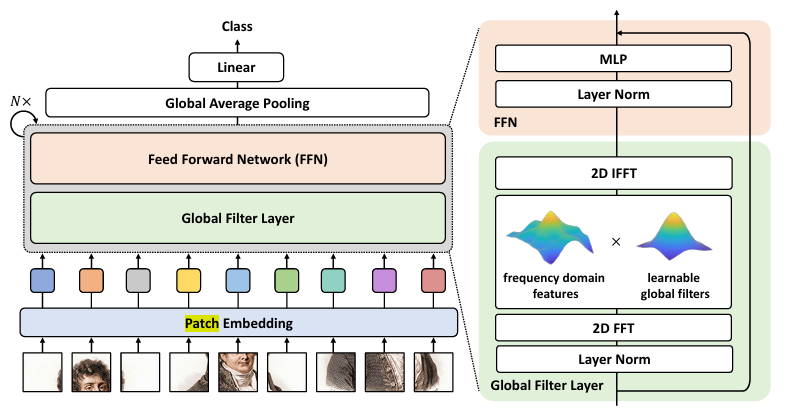
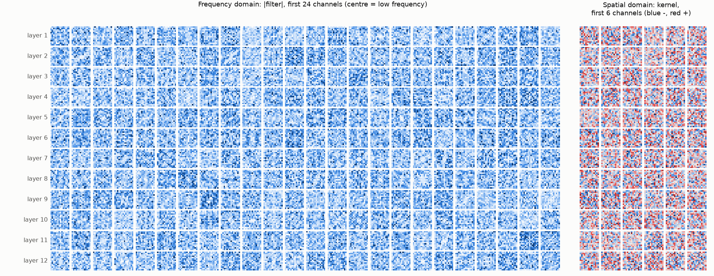
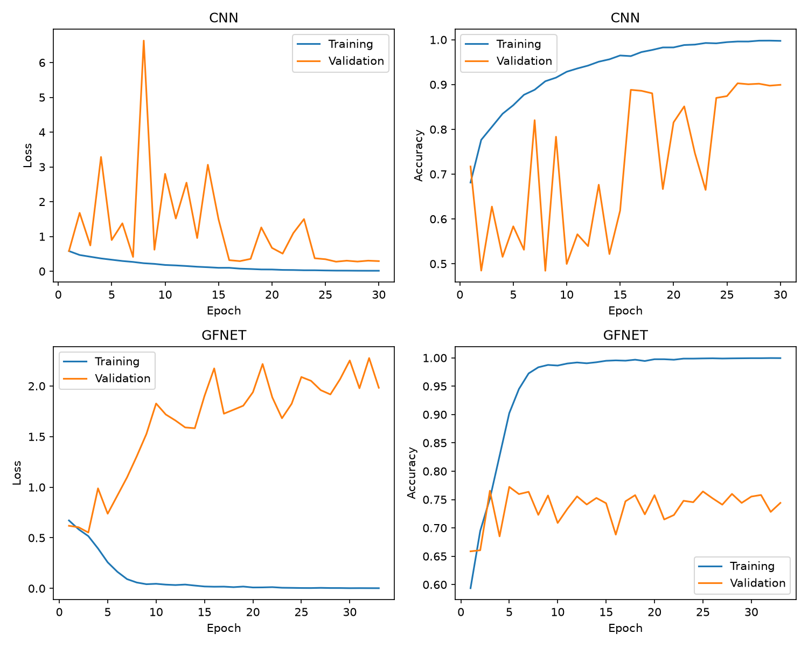
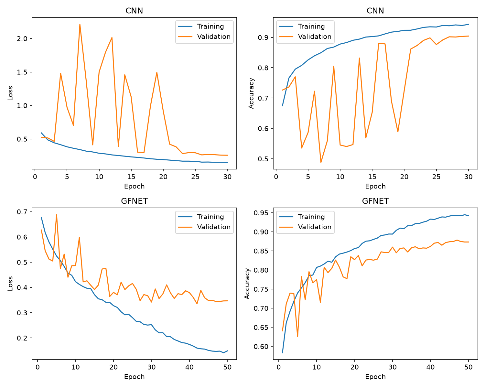
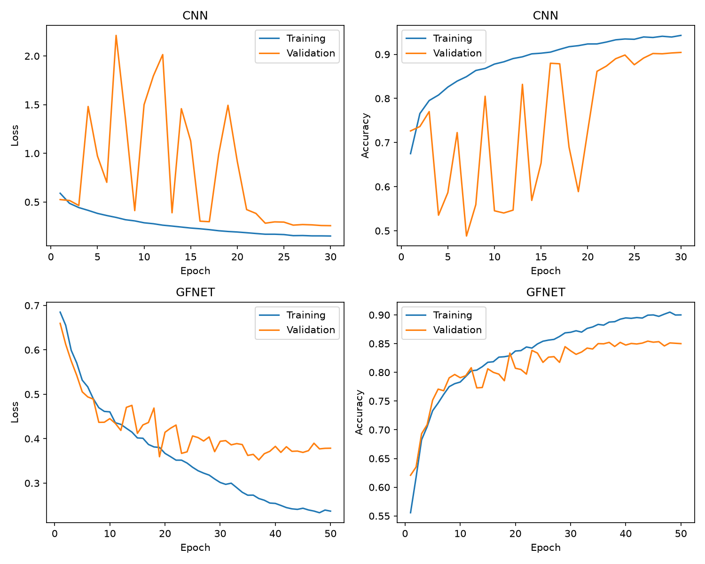
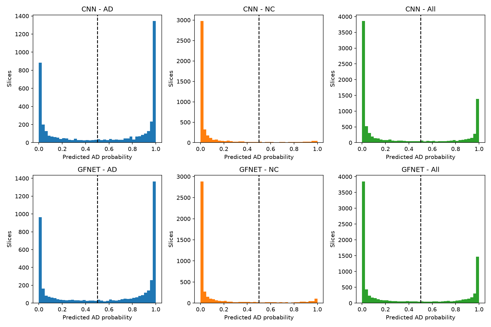

# Diagnosis of Alzheimer's Disease using GFNet on ADNI Brain MRI Dataset
## Introduction

### Problem Description

Alzheimer’s disease is a common form of dementia that affects memory, thinking skills, and the ability to complete daily tasks. Alzheimer’s causes progressive brain atrophy, which becomes visible as shrinkage of the hippocampus and cortex, and enlargement of the ventricles. As such, deep learning models can be employed to learn to detect such changes in the structure of the brain, supporting early screening so that patients can receive early treatment and better outcomes. The purpose of this project is to train and use a Global Filter Network (GFNet) Model to classify brain MRI slices as either having Alzheimer’s Disease (AD) or being Cognitively Normal (CN). The GFNet Model will be compared against a simple baseline model to evaluate whether its added complexity and computational cost provide a meaningful improvement in classification performance. The model will be trained on the ADNI (Alzheimer’s Disease Neuroimaging Initiative) dataset, which contains T1-weighted structural brain MRI scans from AD and CN subjects.

### Algorithm Description

GFNet [1] is a vision-transformer style architecture that replaces the self-attention sub-layer with a global filter layer. Each 224x224 input image is split into 16x16 patches, giving a 14x14 grid of 196 tokens. Each patch is linearly embedded into a 256-dimensional token, and a learnable positional embedding is added. The tokens then pass through a stack of 12 GFNet Blocks. Each of these blocks applies layer normalisation, the global filter layer, a second layer normalisation, and a feed-forward MLP, with a single residual connection around the whole block, as per the official implementation [2].

The global filter layer consists of three main operations:

1. A 2D discrete Fourier Transform to convert the input features to the frequency domain.
2. An element-wise multiplication between the frequency domain features and the global filters.
3. A 2D inverse Fourier transform to convert the features back to the spatial domain.

This is equivalent to a circular convolution with a kernel as large as the whole token grid, so every region of the brain can influence every other region in a single layer. It does this at O(L log L) cost in the number of tokens L, compared with O(L²) for self-attention.

After the final block, a layer normalisation is applied, the tokens are averaged (global average pooling), and a linear classification head outputs the AD/CN prediction. The network is trained with cross-entropy loss.



## Feasibility Review

**Intended user:** Radiologists and other medical professionals who review T1-weighted brain MRIs for Alzheimer’s disease. The prototype is an assistant for diagnosis, and not a replacement. It handles high-confidence AD/CN cases and forwards ambiguous, low-confidence cases to a specialist for review.

**Scope:** Binary AD vs CN classification from the 20 pre-processed 2D slices per patient in the ADNI dataset. GFNet is compared against a simple CNN baseline on identical training/validation/test splits. Performance is reported at both the slice and patient level.

**Acceptance criteria:**

- **Accuracy:** GFNet must achieve >=80% slice-level accuracy on the test set.
- **Quantitative metrics:** Per-class precision and recall, macro-F1 and AUROC must be reported. AD recall has the highest priority because missed AD cases have the most severe consequences.
- **Confidence:** A confidence threshold will be chosen on the validation set such that cases above it are automated, and cases below are forwarded to a specialist for review.
- **Resources:** Peak VRAM <= 8GB, parameter count <= 25M. Inference latency per patient is reported for both models.

**Model Choice and Course Concepts:**

- **Model:** GFNet (Hard Difficulty)
- **Baseline:** A simple CNN with 4 blocks (Conv 3x3 -> BatchNorm -> ReLU -> MaxPool 2x2), followed by global average pooling and a linear head.
- **Dataset:** ADNI brain MRI dataset

**Preliminary results:**

A data audit was conducted to understand the properties of the dataset, and to verify that the train, validation, and test splits are separated at the patient level with no leakage.

```text
== Counts ==
split  class   images  patients
train  AD       10400       520
train  NC       11120       556
test   AD        4460       223
test   NC        4540       227

== Image properties (sample of 200) ==
sizes: {(256, 240): 200}
modes: {'L': 200}
intensity range: 0..255

== Leakage checks ==
patients in both train and test: 0
patients in both AD and NC (train): 0
patients in both AD and NC (test): 0
PASS: no patient-level leakage

== Slices per patient ==
train  AD    min=20 max=20 most common=[(20, 520)]
train  NC    min=20 max=20 most common=[(20, 556)]
test   AD    min=20 max=20 most common=[(20, 223)]
test   NC    min=20 max=20 most common=[(20, 227)]

== Validation split (patients) ==
train AD=442 NC=473 total=915 AD share=0.48
val   AD=78 NC=83 total=161 AD share=0.48
test  AD=223 NC=227 total=450 AD share=0.50

Saved patient lists to splits/val_split.json
```

The dataset is roughly balanced, with AD patients making up 48-50% of total patients across all splits. Every patient has exactly 20 slices. Leakage checks confirm that no patient ID appears in more than one split or in both classes. The image have uniform size and intensity range, so preprocessing only requires resizing (cropping) and normalisation.

**Risks:**

- **Overfitting:** GFNet can memorise the training set instead of learning patterns. This can be mitigated using data augmentation, and a stronger model.
- **Asymmetric error cost:** A false negative is far more costly than a false positive. To mitigate this, AD recall must be prioritised when selecting an operating threshold.
- **Hidden leakage:** The leakage check above only checks patient IDs. If one patient has more than one ID, their scans can appear in both training and test sets, which cannot be detected.

**Budget:** A single A100 GPU on Rangpur. The main constraint is queue wait times and GPU availability.

**Next planned experiment:** Train both models with data augmentation, and measure performance on the test set.

**Fallbacks:**

- **Overfitting:** Can reduce depth or embedding dimension, increase stochastic depth, strengthen augmentation.
- **Underfitting:** Can increase depth or embedding dimension, or train for more epochs.
- **Patient-level aggregation:** Can average predictions across each patient’s 20 slices to smooth out noisy individual slices.

## Dependencies + Reproducibility of Results
**Project Dependencies:**
This project has the following dependencies:

- python - v3.11.16
- torch - v2.13.0
- torchvision - v0.28.0
- numpy - v2.4.6
- pillow - v12.3.0
- scikit-learn - v1.9.0
- matplotlib - v3.11.1

**Reproducibility of Results:**


## Inputs, Outputs, Plots

### Training

To train the GFNet model on the ADNI dataset, run the following command from the project directory:

```bash
python train.py --model gfnet
```

The script trains the model on a patient-level training split, as outlined in the Data Preprocessing and Training section below. The script evaluates the model on the validation split after each epoch, and saves the checkpoint with the lowest validation loss to `runs/`. An abbreviated log from the final training run is shown below (* indicates that a checkpoint was saved):

```text
Run gfnet_20261027_144653 | device NVIDIA A100-PCIE-40GB | gfnet: 7,124,226 parameters
epoch   1 | lr 1.00e-07 | train loss 0.6760 acc 0.583 | val loss 0.6273 slice acc 0.641 patient acc 0.652 auroc 0.741 | 40s 1.57GB *
epoch   2 | lr 2.01e-05 | train loss 0.6170 acc 0.662 | val loss 0.5450 slice acc 0.711 patient acc 0.708 auroc 0.841 | 38s 1.57GB *
epoch   3 | lr 4.01e-05 | train loss 0.5799 acc 0.692 | val loss 0.5122 slice acc 0.739 patient acc 0.776 auroc 0.860 | 39s 1.57GB *
epoch   4 | lr 6.00e-05 | train loss 0.5511 acc 0.718 | val loss 0.5045 slice acc 0.739 patient acc 0.807 auroc 0.887 | 37s 1.57GB *
epoch   5 | lr 8.00e-05 | train loss 0.5243 acc 0.740 | val loss 0.6879 slice acc 0.626 patient acc 0.627 auroc 0.884 | 37s 1.57GB
epoch   6 | lr 1.00e-04 | train loss 0.5063 acc 0.753 | val loss 0.4747 slice acc 0.783 patient acc 0.839 auroc 0.897 | 37s 1.57GB *
epoch   7 | lr 9.99e-05 | train loss 0.4833 acc 0.767 | val loss 0.5319 slice acc 0.722 patient acc 0.745 auroc 0.909 | 38s 1.57GB
epoch   8 | lr 9.95e-05 | train loss 0.4574 acc 0.785 | val loss 0.4404 slice acc 0.796 patient acc 0.826 auroc 0.921 | 37s 1.57GB *
epoch   9 | lr 9.89e-05 | train loss 0.4479 acc 0.787 | val loss 0.4859 slice acc 0.766 patient acc 0.807 auroc 0.921 | 37s 1.57GB
epoch  10 | lr 9.81e-05 | train loss 0.4227 acc 0.807 | val loss 0.4865 slice acc 0.775 patient acc 0.789 auroc 0.927 | 37s 1.57GB
...
epoch  41 | lr 1.17e-05 | train loss 0.1679 acc 0.932 | val loss 0.3607 slice acc 0.870 patient acc 0.925 auroc 0.975 | 37s 1.57GB
epoch  42 | lr 9.55e-06 | train loss 0.1598 acc 0.936 | val loss 0.3354 slice acc 0.872 patient acc 0.932 auroc 0.975 | 37s 1.57GB *
epoch  43 | lr 7.60e-06 | train loss 0.1571 acc 0.939 | val loss 0.3888 slice acc 0.865 patient acc 0.919 auroc 0.974 | 37s 1.57GB
epoch  44 | lr 5.85e-06 | train loss 0.1559 acc 0.938 | val loss 0.3594 slice acc 0.872 patient acc 0.925 auroc 0.975 | 37s 1.57GB
epoch  45 | lr 4.32e-06 | train loss 0.1509 acc 0.941 | val loss 0.3484 slice acc 0.874 patient acc 0.925 auroc 0.976 | 37s 1.57GB
epoch  46 | lr 3.02e-06 | train loss 0.1480 acc 0.943 | val loss 0.3491 slice acc 0.875 patient acc 0.932 auroc 0.976 | 37s 1.57GB
epoch  47 | lr 1.94e-06 | train loss 0.1470 acc 0.943 | val loss 0.3445 slice acc 0.878 patient acc 0.925 auroc 0.976 | 37s 1.57GB
epoch  48 | lr 1.09e-06 | train loss 0.1478 acc 0.942 | val loss 0.3450 slice acc 0.875 patient acc 0.932 auroc 0.976 | 37s 1.57GB
epoch  49 | lr 4.87e-07 | train loss 0.1416 acc 0.945 | val loss 0.3466 slice acc 0.873 patient acc 0.932 auroc 0.976 | 37s 1.57GB
epoch  50 | lr 1.22e-07 | train loss 0.1489 acc 0.942 | val loss 0.3469 slice acc 0.873 patient acc 0.932 auroc 0.976 | 37s 1.57GB

Best epoch 42: val loss 0.3354, slice acc 0.872, patient acc 0.932, patient AUROC 0.975
```

### Inference

Once trained, the model can be evaluated on the test set using the following command:

```bash
python predict.py
```

This loads the saved checkpoint, runs inference on every test slice, and prints a summary of slice-level and patient-level performance. The inputs to the model are the test images from the ADNI dataset, preprocessed as per the Data Preprocessing and Training section below. An example of the output is shown below:

```text
Model: gfnet from gfnet_20261027_144653 (epoch 42) on cuda
Running inference on 9,000 test slices...

Metric                      Slice level  Patient level
------------------------------------------------------
Count                             9,000            450
Accuracy                          0.736          0.762
AUROC                             0.800          0.840
Macro-F1                          0.729          0.754
Sensitivity (AD recall)           0.585          0.583
Specificity (NC recall)           0.884          0.938
Precision AD                      0.832          0.903
Precision NC                      0.684          0.696
Cross-entropy loss                1.157              -

Patient-level confusion matrix (AD = positive, threshold 0.5)
              Pred NC  Pred AD
True NC           213       14
True AD            93      130

Example patient predictions (first 8 by patient ID)
Patient     True   P(AD)  Predicted  Slice std  Correct
1003730       AD   0.085         NC      0.185  no
1004740       AD   0.067         NC      0.172  no
1005735       AD   0.007         NC      0.008  no
1011824       AD   0.462         NC      0.413  no
1017725       AD   0.004         NC      0.008  no
1020512       AD   0.828         AD      0.235  yes
1029798       AD   0.292         NC      0.228  no
1038941       AD   0.305         NC      0.388  no
```

### Visualisation

To better understand what GFNet learns, the learned filters of all 12 blocks were visualised in the frequency domain, and the spatial domain. Each panel is scaled independently, so the colours show each filter’s shape rather than strength.



The filters appear to show a high degree of noise: with a lack of structure in both the spatial and frequency domains. This will be further discussed later in this report.


## Data Preprocessing and Training

### Dataset Structure

The ADNI dataset was stored on the Rangpur HPC cluster, and had the following folder structure:

```text
/home/groups/comp3710/
└── ADNI/
    └── AD_NC/
        ├── train/
        │   ├── AD/    10,400 slices (520 patients)
        │   └── NC/    11,120 slices (556 patients)
        └── test/
            ├── AD/     4,460 slices (223 patients)
            └── NC/     4,540 slices (227 patients)
```

### Data Preprocessing

In the initial data audit, a patient-level validation split, consisting of 15% of the training patients, was created. This split was saved to `splits/val_split.json`. Additionally, the pixel mean and standard deviation were computed from the training patients only. To preprocess the data, each 256 × 240 greyscale slice was centre-cropped to 224 × 224 (as per the official implementation [1]), scaled to [0, 1], and normalised using the pixel mean (0.142) and standard deviation (0.242). No data augmentation was used initially.

### Model Definition

Firstly, the two models (GFNet and baseline CNN) were defined in `modules.py`.

The implementation of GFNet follows the GFNet-Ti configuration of Rao et al. [1] (patch size 16, embedding dimension 256, depth 12, MLP ratio 4, 224 × 224 input), adapted to a 1-channel greyscale input and a 2-class head that outputs logits for NC and AD, with reference to the official code [2].

The baseline CNN model was defined as follows:

- 4 Convolutional blocks, each: 3x3 convolution (no bias) -> BatchNorm -> ReLU -> 2x2 max-pool
- Channel widths: 32->64->128->256, which reduces the 224x224 input to a 14x14 feature map.
- Global average pooling -> dropout (0.3) -> linear layer giving 2 logits (NC, AD).

### Training

Both models were trained using the same script (`train.py`), on the same data, patient-level splits, and preprocessing. Key training details/parameters are listed below:

- **Loss function:** Cross-entropy on 2 logits (NC, AD), with no label smoothing
- **Optimiser:** AdamW, weight decay 0.05
- **Batch size:** 64 slices
- **Learning rate schedule:** Linear warm-up from ~0, then cosine decay to 0, updated every batch.
- **Precision:** Mixed precision (float16) on GPU
- **Checkpoint selection:** Epoch with the lowest validation loss

The baseline CNN was selected to have a peak learning rate of 3e-4. An initial training run showed its validation accuracy repeatedly collapsing at a higher rate, hence, it was reduced. 1 warm-up epoch was used, with a maximum of 30 epochs per training run. For the GFNet model, the maximum learning rate was 1e-4, with 5 warm-up epochs, and a maximum of 50 epochs per training run.

Several training runs were completed before arriving at the final model.

1. **Training run 1:** The first training run was completed with the standard procedures listed above. Results showed that without any data augmentation, GFNet memorised the training set within approximately 8 epochs, while validation accuracy stayed at around 0.75, demonstrating clear overfitting. Similarly, the CNN also overfit. In addition, the CNN’s validation loss and accuracy were highly unstable for the first 20 epochs, collapsing to approximately 50% accuracy.

<p align="center">
  
</p>

2. **Training run 2:** To address the overfitting that occurred in the previous run, data augmentation was introduced: rotation up to +/- 10 degrees, translation by up to 5% of the image size, and scaling between 0.95 and 1.05. Results showed that GFNet no longer memorised the training set, with the training and validation accuracies rising together. The CNN training curves remain unstable until approximately epoch 20, however, they settle at approximately a 90% validation accuracy, and a slightly lower training accuracy than before, indicating less memorisation.

<p align="center">
  
</p>

3. **Training run 3:** A third training run was completed to investigate whether changing the size of the GFNet model would impact its performance. A smaller GFNet was used, with an embedding dimension of 192, and depth of 6. This yielded very similar results to Training Run 2.

<p align="center">
  
</p>

The GFNet and CNN from training run 2 were selected for all future analysis and evaluation. The larger GFNet was preferred to the smaller one in run 3 as it matches the official implementation.

## Investigation of the Open Research Dilemma

### Quantitative Benchmarking

Using the results from `evaluate.py`, the performance of the two models can be evaluated. The results are summarised below:

```text
CNN (test set)
Metric                      Slice level  Patient level
------------------------------------------------------
Count                             9,000            450
Accuracy                          0.745          0.751
AUROC                             0.825          0.852
Macro-F1                          0.736          0.742
Sensitivity (AD recall)           0.569          0.565
Specificity (NC recall)           0.917          0.934
Precision AD                      0.870          0.894
Precision NC                      0.684          0.686
Cross-entropy loss                0.961              -

GFNET (test set)
Metric                      Slice level  Patient level
------------------------------------------------------
Count                             9,000            450
Accuracy                          0.736          0.762
AUROC                             0.800          0.840
Macro-F1                          0.729          0.754
Sensitivity (AD recall)           0.585          0.583
Specificity (NC recall)           0.884          0.938
Precision AD                      0.832          0.903
Precision NC                      0.684          0.696
Cross-entropy loss                1.157              -
```

Overall, the two models perform very similarly based on the metrics above.

- On the test set, both models have similar slice-level and patient-level accuracies, with GFNet slightly outperforming the CNN at the patient level. Note that patient level predictions were made by taking the average prediction across all slices, with a threshold of 0.5.
- The CNN has a slightly higher AUROC score (0.852 vs 0.840), suggesting that it is slightly better at separating the two classes.
- Both models have a poor patient-level sensitivity (0.583 for GFNet, 0.565 for CNN), meaning that they both miss over 40% of AD patients. This is a serious limitation for screening, because a false negative would falsely reassure a patient with AD and delay their diagnosis and care. On the other hand, the models have high patient-level specificity (0.934 and 0.938), indicating that they can effectively clear healthy patients.
- Similarly, the models have high precision for AD cases (0.894 and 0.903), meaning that an AD prediction is likely to be correct. However, the precision for NC patients is much lower (0.686 and 0.696), indicating that roughly 30% of NC predictions are actually AD.
- The GFNet has a higher cross-entropy loss (1.157 vs 0.961), indicating that GFNet is more overconfident when wrong.

To further investigate the nature of the predictions of the models, a set of histograms were plotted, which show the predicted AD probabilities for both models.

<p align="center">
  
</p>

The histograms confirm the low sensitivity and high specificity: NC slices lie almost entirely below 0.5, while many AD slices sit confidently near 0. So most missed AD cases are confident errors rather than borderline ones, which explains the high test loss of both models.

Overall, based on these results, the CNN is the better choice. It provides equal classification performance, with slightly better confidence. GFNet’s added complexity isn’t justified.


### Resource Profiling

The resource profiling table below summarises key metrics that describe the computational cost of each model.

| Metric | CNN | GFNet-Ti | GFNet ÷ CNN |
|:---|---:|---:|---:|
| Parameters | 388,834 (0.39M) | 7,124,226 (7.1M) | 18.3× |
| Peak training VRAM (batch 64) | 1.32 GB | 1.57 GB | 1.2× |
| Peak inference VRAM (batch 64) | 0.49 GB | 0.16 GB | 0.3× |
| Inference latency per slice (batch 1) | 0.88 ms | 6.58 ms | 7.5× |
| Inference latency per patient (20 slices) | 2.14 ms | 6.71 ms | 3.1× |
| Mean training time per epoch | 34.9 s | 37.2 s | 1.1× |
| Best epoch / epochs run | 30 / 30 | 42 / 50 | |
| Training time to best epoch | 17.5 min | 26.0 min | 1.5× |
| Total training time | 17.5 min | 31.0 min | 1.8× |

> **NOTE:** These metrics were measured on an NVIDIA A100 GPU.

Clearly, the GFNet model is much more computationally expensive compared to the baseline CNN model. This further justifies why the CNN is the better option in this application.


### Qualitative Error Autopsies

### Recommendation

## AI Disclosure

## References